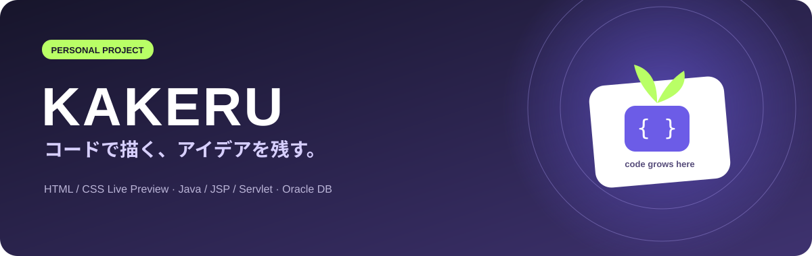
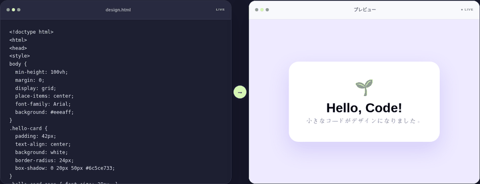
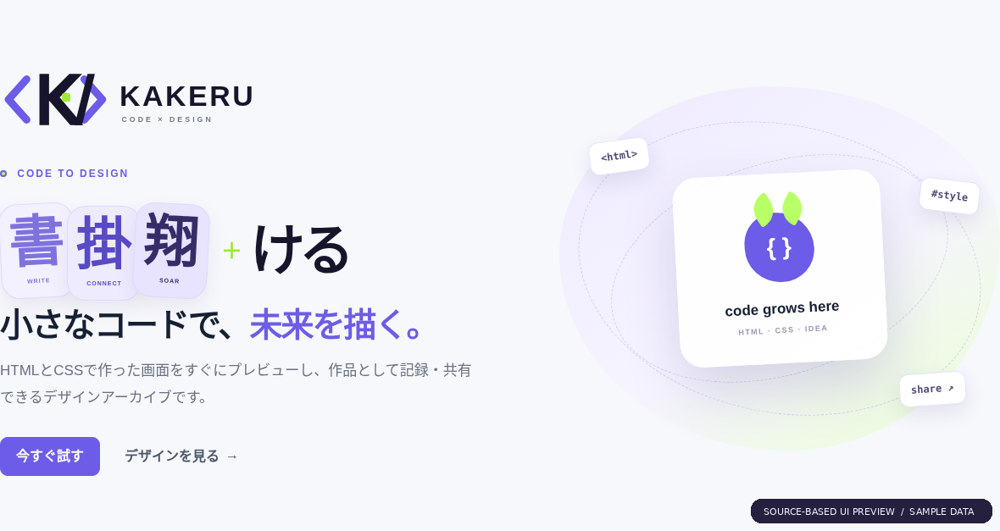
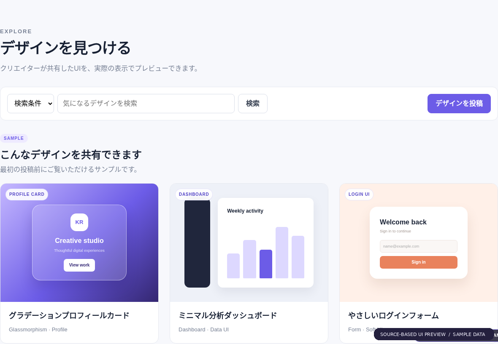
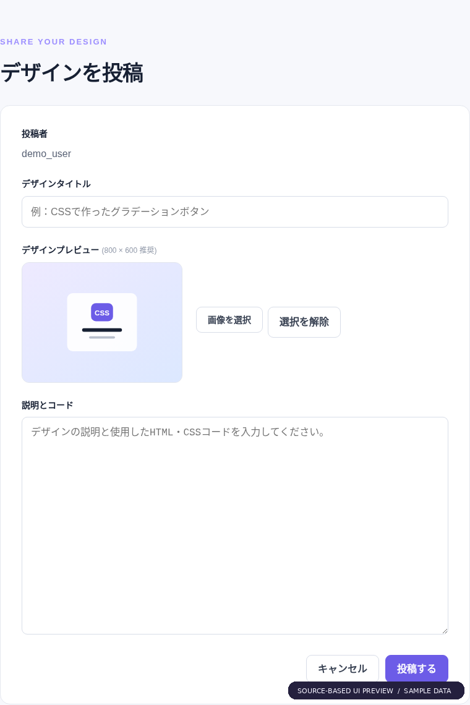
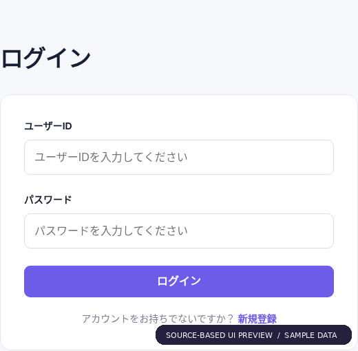
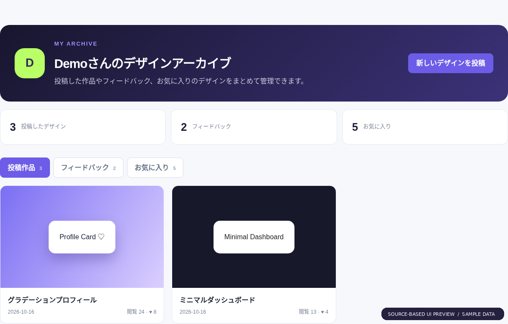
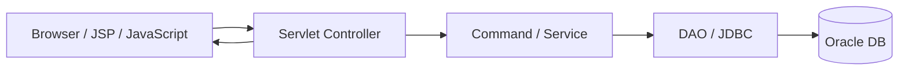

**코드로 디자인하고, 기록하고, 공유하는 개인 웹 프로젝트**

[日本語 README](README.md)

## 프로젝트 개요

KAKERU는 사용자가 작성한 HTML/CSS를 미리보기로 확인하고, 디자인 결과물을 게시글로 기록·공유할 수 있는 개인 개발 웹 애플리케이션입니다. 단순한 게시판을 넘어, **코드 작성 → 결과 확인 → 작품 공유**라는 사용자 흐름을 구현하는 것을 목표로 했습니다.

- **개발 유형:** 개인 프로젝트 — 기획, UI 설계, 프런트엔드, Java 웹 기능, DB 연동
- **기술:** Java, JSP, Servlet, JDBC, Oracle SQL, HTML/CSS, JavaScript, jQuery
- **기반 환경:** Java 21 / Tomcat 10.1 기반 Dockerfile 존재 (배포 설정 추가 정비 필요)
- **배포 현황:** 공개 라이브 데모는 아직 없음

## 핵심 기능

| 기능 | 구현 내용 | 코드 |
|---|---|---|
| HTML/CSS 실시간 미리보기 | 입력한 코드를 `iframe.srcdoc`에 반영, 180ms 디바운스 | [`home.js`](src/main/webapp/js/home.js) |
| 코드 가져오기 | `sessionStorage`로 편집 중인 코드를 작성 화면에 전달 | [`write.js`](src/main/webapp/js/write.js) |
| 작품 게시판 | 글 작성·목록·상세·수정·삭제, 이미지 업로드 | [`BoardController`](src/main/java/controller/BoardController.java) |
| 검색·인기글 | 제목/내용/작성자 검색, 페이지 처리, 좋아요 인기 순위 | [`BoardDAO`](src/main/java/model/BoardDAO.java) |
| 댓글·좋아요 | `fetch`+JSON 비동기 처리, 좋아요 DB 트랜잭션 | [`LikeDAO`](src/main/java/model/LikeDAO.java) / [`view.jsp`](src/main/webapp/board/view.jsp) |
| 계정·마이페이지 | 회원가입·로그인, BCrypt 암호 해싱, 내 게시물·댓글·좋아요 조회 | [`mypage.jsp`](src/main/webapp/mem/mypage.jsp) |

## 대표 기능: 라이브 프리뷰

  

위 GIF는 실제 `home.js`와 소스의 화면 마크업을 이용하여 **프런트엔드 동작을 검증한 예시**입니다. DB를 연결한 전체 서비스 화면이 아닙니다.

## 화면 미리보기

아래 화면은 원본 JSP·CSS 구조를 이용해 만든 **샘플 UI 미리보기**입니다. 실제 운영 서버 캡처가 아닙니다.

| 작품 목록 | 작성 화면 |
|:--:|:--:|
|  |  |

| 로그인 | 마이페이지 |
|:--:|:--:|
|  |  |

## 시스템 구조

## 기술적으로 강조할 구현

1. **즉시 확인 가능한 개발 경험:** HTML/CSS 입력을 `iframe.srcdoc`으로 즉시 미리보기하고, `sandbox` 속성으로 미리보기 프레임을 분리했습니다.
2. **데이터 정합성:** 좋아요 레코드와 카운트를 한 트랜잭션에서 처리하고 실패 시 롤백하도록 설계했습니다.
3. **비동기 UX:** 상세 화면의 댓글·좋아요 기능에 `fetch`와 JSON 응답을 활용했습니다.
4. **비밀번호 저장:** BCrypt 해싱과 로그인 시 해시 비교를 적용했습니다. 평문 비밀번호 디버그 로그를 제거하고 DB 접속정보는 Git 관리 밖의 로컬 설정으로 분리했습니다.

## 개발하며 배운 점

개인 프로젝트에서는 기능별 코드를 구현하는 것 이상으로 **사용자가 작업을 시작하고, 결과를 확인하고, 다시 자신의 작품을 찾는 전체 흐름**을 연결하는 일이 중요하다는 것을 배웠습니다. 개발자의 편의만이 아니라 사용자의 행동 순서를 기준으로 화면 배치와 기능 연결을 고민했습니다.

또한 화면을 만드는 기술뿐 아니라 서버 요청 처리, 데이터베이스 반영, 상태 갱신까지 연결해야 하나의 서비스가 된다는 점을 경험했습니다. 향후에는 운영 환경 통합 테스트, 예외 처리, 접근 제어와 보안 점검을 보강할 계획입니다.

## 공개·실행 안내

이 저장소는 **소스코드 중심**입니다. Oracle DB 스키마·접속 설정 및 Tomcat 배포 구성이 추가로 필요합니다. 현재 Dockerfile은 컴파일된 클래스를 포함하지 않으므로 별도 보완 없이 실행 가능하다고 단정할 수 없습니다.

DB 접속정보는 환경변수 또는 Git에서 제외된 `db.properties`로 관리하며, 공개용 형식은 `src/main/java/db.properties.example`에서 확인할 수 있습니다. 운영 배포 전에는 파일 업로드 경로와 형식 검증, CSRF 방어 등을 추가로 보강할 계획입니다.
