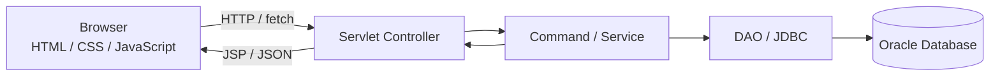

<div align="center">


<br />

**書ける × 掛ける × 翔ける — コードから生まれたデザインを、記録し、共有する。**

HTML/CSSのプレビュー機能と作品投稿を組み合わせた、個人開発のWebアプリケーションです。

<br />


**[主要機能](#-主要機能) · [画面プレビュー](#-画面プレビュー) · [技術的な工夫](#-技術的な工夫) · [構成](#-システム構成) · [学んだこと](#-開発を通じて学んだこと)**

[한국어 설명 / Korean README](README.ko.md)

</div>

---

## 01. プロジェクト概要

**KAKERU** は、HTML/CSSで作った小さなデザインを、その場で試し、作品として残せるWebプラットフォームです。

一般的な掲示板ではコードを「文章」として保存するだけになりがちです。KAKERUでは、**コードとその表示結果の両方を扱える体験**を目指しました。日本語の「書ける」「掛ける」「翔ける」という言葉を組み合わせ、**書く → 形にする → 共有する**という流れをコンセプトにしています。

| 項目 | 内容 |
| :-- | :-- |
| 開発形式 | **個人開発**：企画、画面設計、フロントエンド、Servlet/JDBC、DB連携 |
| 開発環境 | Java 21 / Tomcat 10.1 を想定（Dockerfileのベースイメージより） |
| 主な技術 | Java, JSP, Servlet, JDBC, Oracle SQL, HTML/CSS, JavaScript, jQuery |
| 特徴 | ライブプレビュー、デザイン投稿・検索、いいね・コメント、マイページ |
| 公開デモ | **未公開**（リポジトリには紹介用プレビューを掲載） |

> **画面について：** 下記の画像はプロジェクトのJSP/HTML/CSSをもとに作成した**UIテンプレートのプレビュー**です。DB接続を伴う実運用画面のスクリーンショットではなく、サンプルデータを含みます。動作内容はソースコードを確認したもので、全機能の本番環境テスト完了を意味しません。

## 02. 3ステップで使う

```text
  ① WRITE              ② PREVIEW                ③ SHARE
  HTML / CSSを書く  →   iframeで表示を確認   →   投稿・コメント・いいね
```

### メイン機能：コードを編集すると、その場で表示が変わる

<div align="center">
  
  <br />
  <sub>実際の <code>home.js</code> と編集用HTMLを使用したフロントエンド動作確認。DBを必要としない機能です。</sub>
</div>

- 左側のエディターに入力したHTML/CSSを、右側の `iframe.srcdoc` に反映
- `input` イベントを **180msでデバウンス**し、入力中の更新を制御
- 「このデザインで投稿」では、コードを `sessionStorage` に一時保存して投稿画面へ渡す
- プレビューは `sandbox` 属性を付けた `iframe` で表示

**関連ソース：** [`index.jsp`](src/main/webapp/index.jsp) · [`home.js`](src/main/webapp/js/home.js) · [`write.js`](src/main/webapp/js/write.js)

## 03. 主要機能

| 機能 | 実装内容 | 主なソース |
| :-- | :-- | :-- |
| **ライブプレビュー** | HTML/CSS入力 → `iframe.srcdoc` 反映、投稿画面へコード引き継ぎ | [`home.js`](src/main/webapp/js/home.js) |
| **作品管理** | 投稿・一覧・詳細・編集・削除、画像添付 | [`BoardController`](src/main/java/controller/BoardController.java) / [`BoardDAO`](src/main/java/model/BoardDAO.java) |
| **検索・ページネーション** | タイトル・本文・投稿者で検索、件数に応じたページ表示 | [`BoardList`](src/main/java/service/BoardList.java) / [`BoardDAO`](src/main/java/model/BoardDAO.java) |
| **人気デザイン** | いいね数による作品ランキング表示 | [`PopularCommand`](src/main/java/service/PopularCommand.java) |
| **いいね** | ユーザーごとの登録・解除、件数更新をJDBCトランザクションで処理 | [`LikeDAO`](src/main/java/model/LikeDAO.java) |
| **コメント** | 投稿・編集・削除をJSONレスポンスと非同期通信で更新 | [`ReplyWrite`](src/main/java/service/ReplyWrite.java) / [`view.jsp`](src/main/webapp/board/view.jsp) |
| **会員・マイページ** | 登録・ログイン、投稿した作品・コメント・いいね履歴 | [`Membercontroller`](src/main/java/controller/Membercontroller.java) / [`mypage.jsp`](src/main/webapp/mem/mypage.jsp) |

## 04. 画面プレビュー

**ソースベースの静的プレビュー（サンプルデータ）**です。掲載画像はライブサーバーのキャプチャではありません。

<div align="center">
  <p><b>01 — TOP / コンセプト</b></p>
  
</div>

<br />

| 02 — デザインを探す | 03 — 投稿画面 |
| :--: | :--: |
|  |  |
| サンプルカード、検索条件、投稿導線 | タイトル・説明・コード・画像の登録フォーム |

| 04 — ログイン | 05 — マイページ |
| :--: | :--: |
|  |  |
| 会員認証の入力画面 | 自分の投稿・コメント・いいね履歴を確認 |

## 05. システム構成



- **Controller：** `/blog/*`、`/member/*`、`/blog/reply/*` のリクエスト振り分け
- **Command：** ログイン、投稿、いいね、コメント等のユースケース別処理
- **DAO / DTO：** SQLによるデータ操作と画面へ渡すデータの保持
- **View：** JSPとHTML/CSSによる表示、JavaScriptによる非同期更新

<details>
<summary><b>主要ディレクトリを見る</b></summary>

```text
src/main/
├── java/
│   ├── controller/      # URLルーティング
│   ├── service/         # Command単位の業務処理
│   ├── model/           # DAO / DTO
│   └── util/            # DB接続ユーティリティ
└── webapp/
    ├── board/           # 投稿・一覧・詳細・人気作品
    ├── mem/             # ログイン・会員登録・マイページ
    ├── css/             # 共通 / ページ別デザイン
    ├── js/              # プレビュー・投稿・画面操作
    └── WEB-INF/         # web.xml / ライブラリ
```

</details>

## 06. 技術的な工夫

### 1) `iframe.srcdoc` × `sandbox` — コードと結果をひとつの画面で

ユーザーが記述したHTML/CSSを、ページ遷移なしで表示させるために `iframe.srcdoc` を使用しました。入力イベントを一定時間まとめることで、毎キー入力ごとの更新を避けています。投稿画面への移動時には `sessionStorage` を活用しました。

**[実装を見る：home.js](src/main/webapp/js/home.js)**

### 2) JDBCトランザクション — いいね情報とカウンターの整合性を意識

「いいね」の登録・解除と投稿側の件数更新は、片方だけが成功しないよう同一トランザクションで処理する構成です。成功時に `commit()`、例外時に `rollback()` を呼ぶよう実装しました。

**[実装を見る：LikeDAO.java](src/main/java/model/LikeDAO.java)**

### 3) `fetch` × JSON — コメントの非同期操作

コメント操作ではServlet側がJSONを返し、詳細画面のJavaScriptが `fetch` で送受信します。画面全体を再読み込みせずに更新することを目指した実装です。

**[実装を見る：view.jsp](src/main/webapp/board/view.jsp)** · **[ReplyWrite.java](src/main/java/service/ReplyWrite.java)**

### 4) BCrypt — パスワードのハッシュ化

会員登録時に BCrypt でハッシュ化し、ログイン時に `checkpw()` で照合する構成です。平文パスワードを出力していたデバッグログは削除し、DB接続情報はGit管理外のローカル設定へ分離しました。

**[実装を見る：MemberInsert.java](src/main/java/service/MemberInsert.java)** · **[LoginCommand.java](src/main/java/service/LoginCommand.java)**

## 07. 開発を通じて学んだこと

個人開発では、UIデザインからDB連携までの一連の流れを自分で考え、実装する必要がありました。とくに意識したのは、**「機能を作る」だけでなく「使う人が迷わず作れる・見つけられる・共有できる」こと**です。

コードを書いてすぐに結果を確認できる導線や、作品を投稿してから再び探せる流れを考える中で、フロントエンドとバックエンドを**別々の機能ではなく、一つの利用体験として設計する重要性**を学びました。

今後はDBとサーバーを含む環境での統合テストを充実させ、エラー処理、セキュリティ、デプロイの再現性をより高めていきたいと考えています。

## 08. 動作環境・留意事項

本リポジトリは **Java Webアプリケーションのソースコード**を中心に公開しています。READMEのGIFはフロントエンドのローカル検証であり、Oracle DBを使った全機能の稼働デモではありません。

- 想定環境：**Java 21 / Apache Tomcat 10.1 / Oracle Database / JDBCドライバー**
- DBスキーマと接続設定は実行環境に合わせた準備が必要です。
- `Dockerfile` はありますが、現在の定義ではコンパイル済みクラスの組み込みなど、**そのまま動かすための追加整備が必要**です。
- DB認証情報は環境変数またはGit管理外の `db.properties` から読み込みます。公開用の設定例は `src/main/java/db.properties.example` を参照してください。
- 実運用に向けて、アップロード先の環境依存性解消、CSRF対策、ファイル形式の検証などは追加で強化する必要があります。

---

<div align="center">

**KAKERU — 小さなコードが、次のアイデアにつながる場所。**

<sub>個人開発プロジェクト / Source-based portfolio documentation</sub>

</div>
